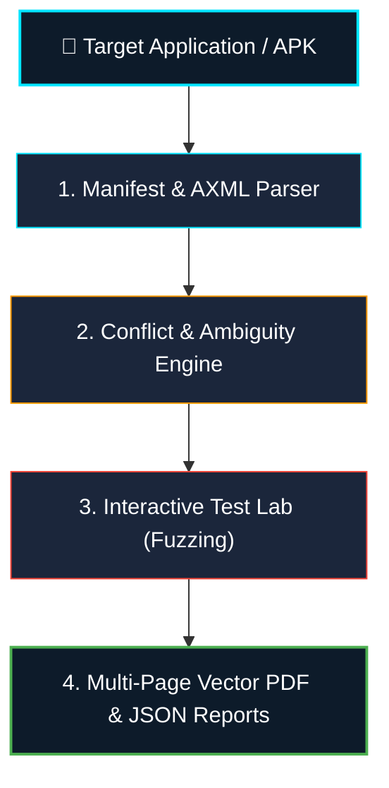

# IntentWatch — Android Deep-Link Hijacking & Intent Security Analyzer

<p align="center">
  
  
  
  
  
</p>

---

**Course:** Android Application Development (24CYS404)  
**Faculty Advisor:** Dr. S. Udhayakumar, Associate Professor, Cyber Security  
**Package Identifier:** `com.intentwatch.security`  
**Companion Vulnerable Benchmark:** `com.vulnerable.bank`  

---

## 📌 Overview

**IntentWatch** is a native, offline-first Android security auditing platform engineered to uncover, analyze, and test deep-link vulnerabilities and intent-based attack surfaces. It targets critical security risks such as **Custom URI Scheme Hijacking (CWE-940)**, **Insecure Intent Redirection / Open Redirects (CWE-601)**, **Broken Android App Links**, and **Exported Component Exposure**.



---

## ✨ Key Features

1. **Dual-Mode Deep-Link Discovery:**
   - **Mode A (Installed Package Inspection):** Queries Android's `PackageManager` and Intent Resolver across device applications, identifying registered schemes, hosts, path constraints, and exported status under Android 11+ package visibility rules.
   - **Mode B (Zero-Installation APK Manifest Parser):** Unpacks and parses compiled binary Android Binary XML (`AndroidManifest.xml`) directly from APK files using a custom zero-dependency parser without installing the APK on the system.

2. **Heuristic Collision & Hijacking Engine:**
   - Groups discovered intent handlers across packages to pinpoint URI scheme collisions.
   - Detects multi-application routing ambiguities where unreserved custom schemes (e.g. `intentwatch-test://` or `bankpay://`) cause the Android OS to invoke the System Resolver (App Chooser dialog), enabling malicious intent interception.
   - Flags missing `android:autoVerify="true"` on HTTP/HTTPS App Links.

3. **Interactive Deep-Link Test Lab & Fuzzer:**
   - 10 structured vulnerability vectors (Baseline, Parameter Dropping, Empty Values, Malformed Syntax, Double-Encoded Traversal, Dangerous Schemes, Open Redirects, Host/Path Ambiguity, Parameter Tampering, Whitelist Enforcement).
   - Safe execution guardrails: Simulates intent resolution via `PackageManager` query before live launch, with sandboxed WebView testing.

4. **Executive Reporting & Export:**
   - Native multi-page vector PDF report generator (`android.graphics.pdf.PdfDocument`) with KPI scorecards, vulnerability breakdown, and developer remediation guidelines.
   - Machine-readable JSON export for DevSecOps pipelines.

---

## 📂 Repository File Tree

```text
IntentWatch/
├── .github/
│   └── workflows/
│       └── android-ci.yml             # GitHub Actions automated build & test CI
├── app/                               # IntentWatch Core Security Analyzer Module
│   ├── src/
│   │   ├── main/
│   │   │   ├── java/com/intentwatch/security/
│   │   │   │   ├── analysis/
│   │   │   │   │   └── ConflictAnalyzer.java         # Heuristic scheme collision engine
│   │   │   │   ├── database/
│   │   │   │   │   └── DatabaseHelper.java           # Local SQLite storage for findings & scans
│   │   │   │   ├── models/
│   │   │   │   │   ├── DiscoveredDeepLink.java       # Discovered endpoint model
│   │   │   │   │   ├── ScanSession.java              # Audit session model
│   │   │   │   │   ├── SchemeConflict.java           # Collision & ambiguity finding model
│   │   │   │   │   ├── SecurityFinding.java          # Severity-rated vulnerability finding
│   │   │   │   │   ├── TestCase.java                 # Structured test case definition
│   │   │   │   │   └── TestResult.java               # Execution outcome & evidence model
│   │   │   │   ├── reports/
│   │   │   │   │   ├── JsonReportGenerator.java      # Machine-readable JSON report exporter
│   │   │   │   │   ├── PdfReportGenerator.java       # 5-page vector PDF document renderer
│   │   │   │   │   └── ReportExporter.java           # SAF & FileProvider share orchestrator
│   │   │   │   ├── scanner/
│   │   │   │   │   ├── ApkManifestParser.java        # Zero-dependency binary AXML decoder
│   │   │   │   │   └── InstalledAppScanner.java      # PackageManager deep-link discovery
│   │   │   │   ├── testing/
│   │   │   │   │   ├── DeepLinkFuzzer.java           # 10-vector parameter & path fuzzer
│   │   │   │   │   └── SafeTestExecutor.java         # Guarded intent dispatch & simulation
│   │   │   │   ├── testtarget/
│   │   │   │   │   ├── CompetingTargetActivity.java  # Competing activity for intra-app collision
│   │   │   │   │   ├── SecureDeepLinkActivity.java   # Hardened whitelist reference implementation
│   │   │   │   │   └── VulnerableDeepLinkActivity.java # Open redirect testbed activity
│   │   │   │   └── ui/
│   │   │   │       ├── MainActivity.java             # Main container & bottom navigation
│   │   │   │       ├── adapters/                     # RecyclerView adapters for cards & tables
│   │   │   │       ├── dialogs/                      # Safe execution confirmation modals
│   │   │   │       ├── fragments/                    # Dashboard, Scanner, Conflicts, TestLab, Reports
│   │   │   │       └── webview/
│   │   │   │           └── SafeWebViewActivity.java  # Sandboxed web container
│   │   │   ├── res/                                  # Layouts, vector icons, dark theme colors
│   │   │   └── AndroidManifest.xml                   # IntentWatch manifest with audit permissions
│   │   └── test/java/com/intentwatch/security/       # JUnit 4 unit tests (100% pass)
│   └── build.gradle                                  # App module dependencies & packaging
├── vulnerableapp/                     # Companion Target Benchmark (Vulnerable Bank)
│   ├── src/main/
│   │   ├── java/com/vulnerable/bank/
│   │   │   ├── BankDashboardActivity.java            # Main account dashboard
│   │   │   ├── DebugConsoleActivity.java             # Unprotected exported diagnostic activity
│   │   │   ├── PaymentTransferActivity.java          # Wildcard custom scheme payment receiver
│   │   │   └── VulnerableDeepLinkActivity.java       # Colliding custom scheme activity
│   │   ├── res/
│   │   └── AndroidManifest.xml                       # Manifest with vulnerable intent filters
│   └── build.gradle
├── docs/
│   ├── AUDIT_REPORT_TEMPLATE.md       # Comprehensive security audit report
│   └── DEMO_WALKTHROUGH.md            # Hackathon pitch & step-by-step presentation script
├── sample_apks/
│   └── VulnerableBankDemo.apk         # Compiled vulnerable target for offline APK import
├── .gitignore                         # Standard Android / Gradle ignore rules
├── CONTRIBUTING.md                    # Contribution guidelines
├── LICENSE                            # MIT License
├── README.md                          # Repository documentation
├── build.gradle                       # Root build configuration
├── gradle.properties                  # Gradle JVM & AndroidX settings
├── gradlew & gradlew.bat              # Gradle wrappers
└── settings.gradle                    # Multi-module definition (:app, :vulnerableapp)
```

---

## 🚀 Quick Start & Installation

### Prerequisites
- **Android Studio:** Hedgehog | Iguana | Jellyfish | Koala
- **Java Development Kit:** JDK 17
- **Android SDK:** API 26 (Android 8.0) to API 34 (Android 14)

### 1. Clone & Open
```bash
git clone https://github.com/your-username/IntentWatch.git
cd IntentWatch
```
Open the project directory in Android Studio and let Gradle sync.

### 2. Build via Command Line
```bash
# Build both IntentWatch Analyzer and the Vulnerable Target APK
./gradlew assembleDebug

# Run unit tests
./gradlew testDebugUnitTest
```

APKs will be generated at:
- Analyzer: `app/build/outputs/apk/debug/app-debug.apk`
- Target Benchmark: `vulnerableapp/build/outputs/apk/debug/vulnerableapp-debug.apk`

### 3. Deploy to Emulator or Device
```bash
# Install IntentWatch Analyzer
adb install app/build/outputs/apk/debug/app-debug.apk

# Install Vulnerable Bank Benchmark Target
adb install vulnerableapp/build/outputs/apk/debug/vulnerableapp-debug.apk
```

---

## 🧪 Live Demo & Fuzzing Scenarios

| Test Scenario | URI Payload | Vulnerability Highlighted |
| :--- | :--- | :--- |
| **Scheme Hijacking** | `intentwatch-test://vulnerable` | Triggers Android's **App Chooser Dialog** across `com.intentwatch.security` and `com.vulnerable.bank`. |
| **Open Redirection** | `intentwatch-test://vulnerable?redirect_url=https://attacker-controlled.site&action=redirect` | Exploits unvalidated intent forwarding to trampoline users to an untrusted domain. |
| **Path Traversal** | `intentwatch-test://vulnerable?redirect_url=%252e%252e%252f%252e%252e%252fetc%252fshadow` | Fuzzes URI parser against double-encoded path traversal characters. |
| **Hardened Whitelist** | `intentwatch-test://secure?auth_token=valid_token&redirect_url=https://evil.com` | `SecureDeepLinkActivity` evaluates against internal host whitelist and safely halts execution. |

👉 For the complete 5-stage demonstration script and Hackathon presentation pitch, see [docs/DEMO_WALKTHROUGH.md](docs/DEMO_WALKTHROUGH.md).

---

## 📄 Security Audit Report

IntentWatch produces full-spectrum, cryptographic-ready technical reports. Review the sample report produced during testing:
- **[Read Full Security Audit Report (Markdown)](docs/AUDIT_REPORT_TEMPLATE.md)**

---

## 🛡️ Responsible Disclosure & Security

IntentWatch is developed for defensive security research, academic training, and application hardening under authorized conditions. See [SECURITY.md](SECURITY.md) for details.

---

## 🎓 Academic Attribution

- **Course:** Android Application Development (24CYS404)
- **Faculty Guide:** Dr. S. Udhayakumar, Associate Professor, Cyber Security
- **Developed by:** Cybersecurity & Mobile Application Engineering Team
