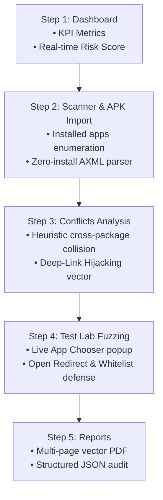

# IntentWatch — Hackathon Presentation & Live Demo Walkthrough

**Course:** Android Application Development (24CYS404)  
**Faculty Advisor:** Dr. S. Udhayakumar, Associate Professor, Cyber Security  
**Project:** IntentWatch — Android Deep-Link Hijacking & Intent Security Analyzer  

---

## 3-Minute Hackathon Pitch Script

> *"Good morning, judges and faculty. Every day, millions of Android users click deep links in emails, SMS, and QR codes to open banking apps, payment gateways, and social networks. But did you know that custom URI schemes like `myapp://` have **zero cryptographic ownership in Android**? Any malicious app installed on your phone can register the exact same scheme and silently hijack your payment requests, session tokens, or one-time codes.*
>
> *Introducing **IntentWatch** — a production-grade, local-first Android mobile security auditing platform. IntentWatch solves this by combining offline APK binary manifest parsing, heuristic conflict correlation, and an interactive deep-link fuzzing lab into an all-in-one mobile cybersecurity tool."*

---

## Live Demo Step-by-Step Sequence

### Stage 1: Executive Dashboard
- **Open IntentWatch on your device.**
- Point to:
  - **Dark Cybersecurity UI:** Navy blue theme with cyan accents, designed following Material 3 guidelines.
  - **KPI Metrics:** Total Handlers, Registered Schemes, Potential Conflicts, and the **Risk Gauge**.
  - **Clean State:** If you just reset, show that the dashboard is ready for an audit.

### Stage 2: Scanner & Zero-Install APK Import
- Tap **Deep-Link Scanner** in the bottom navigation.
- Tap **"Start Scan"**: Watch IntentWatch enumerate installed packages, identify exported activities, and classify schemes.
- Tap **"Import APK"**:
  - Open the file picker, navigate to `Downloads`, and select **`VulnerableBankDemo.apk`**.
  - **Key Pitch Point:** *"IntentWatch parses compiled Binary XML directly from the APK archive without installing it on the phone, protecting the analyst's environment from untrusted code."*
  - Watch the newly discovered intent filters from `com.vulnerable.bank` appear with red `EXPORTED` badges!

### Stage 3: Conflict & Hijacking Analysis
- Switch to the **Conflicts** tab.
- Tap the **`intentwatch-test://`** card displaying **CRITICAL (90/100)**.
- **Explain the Vulnerability:**
  - *"Here is our core research finding: 6 activities across two completely independent packages (`com.intentwatch.security` and `com.vulnerable.bank`) claim the identical `intentwatch-test://` scheme."*
  - Show the **Conflict Details Dialog**: Review the heuristic scoring breakdown (+35 for cross-package collision, +30 for handler overlap, +25 for external reachability).

### Stage 4: Test Lab — Live Hijacking & Fuzzing Proof
- Switch to the **Test Lab** tab.
- **Test 1 (Live Hijacking Collision):**
  - Enter: `intentwatch-test://vulnerable`
  - Tap **"Execute Test"** -> Observe the Android system **"Open with"** chooser dialog pop up!
  - *"This proves the vulnerability live on the device: Android cannot decide which app to open, allowing an attacker to intercept the communication."*
- **Test 2 (Open Redirection):**
  - Enter: `intentwatch-test://vulnerable?redirect_url=https://attacker-controlled.site&action=redirect`
  - Tap **"Execute Test"** -> Show the unvalidated redirect alert in the results log.
- **Test 3 (Hardened Whitelist Defense):**
  - Enter: `intentwatch-test://secure?auth_token=valid_token&redirect_url=https://evil.com`
  - Tap **"Execute Test"** -> Show that `SecureDeepLinkActivity` validates against the internal whitelist and blocks the attack.

### Stage 5: Executive PDF & JSON Report Export
- Switch to the **Reports** tab.
- Tap **"Export PDF Audit Report"**:
  - Open the PDF in the viewer.
  - Point to the executive cover page, risk scorecard, CVE/CWE weakness mapping, and the developer remediation guide.
- Tap **"Export JSON Audit"**:
  - Show the machine-readable JSON structure for integration into automated DevSecOps CI/CD pipelines.

---

## Technical Q&A Preparation for Judges

**Q: Why can't Android prevent two apps from claiming the same custom scheme?**  
*A: By design, custom URI schemes (`scheme://`) do not have a domain registrar or TLS certificate authority. Android delegates resolution to the user via the Intent Resolver dialog. Only Android App Links (`https://`) with `android:autoVerify="true"` and a valid `/.well-known/assetlinks.json` can establish cryptographic domain ownership.*

**Q: How does IntentWatch parse APKs without root or external libraries?**  
*A: IntentWatch contains a lightweight, custom-built Android Binary XML (AXML) decoding engine in `ApkManifestParser.java`. It decompresses `AndroidManifest.xml` from the APK zip archive and parses the binary string table and XML resource tags natively in Java.*

**Q: Is the score CVSS compliant?**  
*A: IntentWatch implements an explainable heuristic scoring matrix (0–100) combining component reachability, handler overlap, and parameter validation. The generated report maps these heuristic findings directly to industry-standard CVSS v3.1 scores and CWE identifiers (e.g., CWE-940, CWE-601).*
